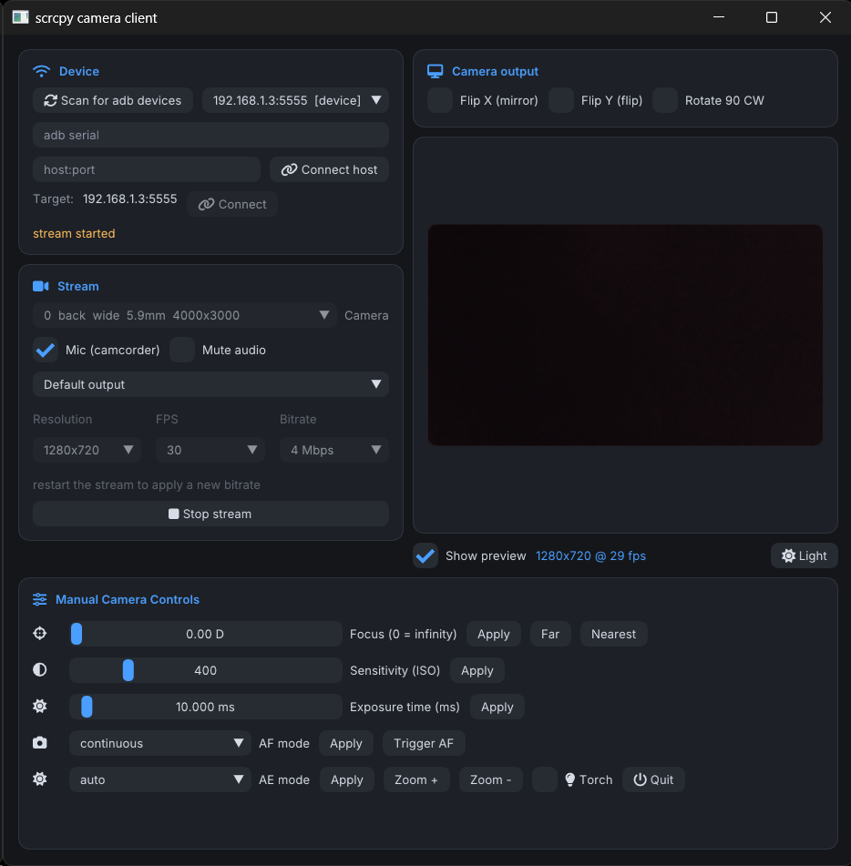

<h1 align="center">scrcpy-cam</h1>

<div align="center">
  
</div>

A camera client for [scrcpy](https://github.com/Genymobile/scrcpy) with manual
camera controls. It pushes the scrcpy server to a device over adb, streams the
camera, and exposes the controls scrcpy does not have a UI for: focus
distance, autofocus mode, exposure time, ISO, zoom and torch.

Decoded frames are published as a virtual camera, so any application that can
open a webcam can use the phone's cameras.

| | |
|---|---|
| Device | Android 12 or higher (camera streaming requirement) |
| Client | Windows and Linux |
| Virtual camera | e2eSoft VCam SDK on Windows, v4l2loopback on Linux |
| UI | Dear ImGui, SDL3 + OpenGL |

## Releases

Prebuilt archives are attached to every
[release](https://github.com/serifpersia/scrcpy-cam/releases). The
[`latest`](https://github.com/serifpersia/scrcpy-cam/releases/latest) tag always
points at the newest build of `master` and is replaced on every push.

| Asset | What you get |
|---|---|
| [`scrcpy-cam-windows.zip`](https://github.com/serifpersia/scrcpy-cam/releases/latest/download/scrcpy-cam-windows.zip) | `scrcpy-cam.exe` with its DLLs and the server |
| [`scrcpy-cam-linux.zip`](https://github.com/serifpersia/scrcpy-cam/releases/latest/download/scrcpy-cam-linux.zip) | `scrcpy-cam` with its shared libraries and the server |

Both are **Release** builds and are self-contained, so there is nothing to
install beyond `adb` and the virtual camera driver. SHA-256 sums are published
alongside the archives as `checksums.txt`.

If you would rather build it yourself, see [Building](#building).

## Requirements

- **Android platform-tools**, with `adb` on your `PATH`. scrcpy-cam shells out to
  `adb` and does not bundle it. If adb lives somewhere else, set the `ADB`
  environment variable to its full path.
- A device **already authorized** for this adb server. Check with `adb devices`:
  a usable device shows as `device`, not `unauthorized` or `offline`.

### Connecting a device

**USB** — turn on Developer options and USB debugging, plug the phone in, and
accept the "Allow USB debugging?" prompt. The device then appears by its serial
after **Scan for adb devices**.

**Network** — enable Wireless debugging, or run `adb tcpip 5555`, then
`adb connect <ip>:5555`. You can also type the address into the `host:port` field
and press **Connect host**. USB and network devices can be used at the same time;
pick whichever you want from the list.

Serial devices have no port, so both manual fields accept one: **adb serial**
always treats what you type as a serial, and **host:port** falls back to that
when the text has no colon. Either way the serial is passed to `adb -s`.

The scan only shows devices adb already knows about, which is why the manual
serial and `host:port` fields exist.

## Features

- Finds cameras over adb, by scanning or by entering a serial or `host:port`
- Lists the cameras the device exposes, including the wide and telephoto lenses
  that some devices hide behind a single logical camera
- Resolution, frame rate, and bitrate selection
- Manual focus distance, AF mode and trigger, exposure time, ISO
- Zoom and torch; flip X, flip Y and rotate on the Windows virtual camera
- Optional mic capture (camcorder source) routed to a selectable audio output, with mute

## Mic / audio

Mic is off by default. Enable **Mic (camcorder)** before starting the stream; scrcpy-cam requests `audio_source=mic-camcorder` and decodes raw PCM on the client, then plays it through SDL to the selected output device. Use **Mute** to silence playback without stopping capture. The e2eSoft VCam path is video-only, so audio is routed through an audio device, not the virtual camera.

- **Windows**: install a virtual audio cable (e.g. VB-CABLE or VoiceMeeter), select its input (e.g. `CABLE Input` / `Voicemeeter AUX Input`) as the scrcpy-cam output device, then in OBS/app select the matching cable output as mic/input. Keep **Mute** off in scrcpy-cam; use the cable/OBS mix if you don't want local monitoring.
- **Linux**: route to a PipeWire/Pulse null sink or virtual device and capture its monitor in OBS/app, or use normal output device selection for local playback. For OBS-only, pick a null sink and keep system monitoring off.

## Building

### Windows

```
build.bat
```

FFmpeg and SDL3 are downloaded into `third_party/` on the first run. Requires
Visual Studio (C++ workload) and CMake.

### Linux

```
sudo apt install build-essential cmake pkg-config \
                 libavcodec-dev libswscale-dev libavutil-dev libsdl3-dev
./build.sh
```

### Virtual camera on Linux

```
sudo modprobe v4l2loopback
```

The v4l2loopback device then shows up in OBS, Zoom and the rest as a normal
camera.

## Usage

Run `scrcpy-cam`, press **Scan for adb devices**, pick a device and press
**Connect**. The resolution, frame rate and bitrate pickers fill in once the
device has been queried. Choose a camera and press **Start stream**.

To connect to a device that is not on adb yet, type its address in the
`host:port` field and press **Connect host**; the typed address takes
precedence over the scanned list.

## Credits

- [scrcpy](https://github.com/Genymobile/scrcpy) by Genymobile, Apache-2.0.
  This client uses the scrcpy server, its control protocol, and the structure of
  its desktop client.
- [Dear ImGui](https://github.com/ocornut/imgui), MIT.
- [FFmpeg](https://ffmpeg.org/), LGPL. Binaries are downloaded at build time,
  not vendored here.
- [SDL](https://libsdl.org/), zlib. Binaries are downloaded at build time.
- The virtual camera sink follows the approach in scrcpy's `--v4l2` support.

## The scrcpy server

The server is not the stock upstream build. It comes from a fork that adds the
manual camera parameter messages this client sends:

- Repository: <https://github.com/serifpersia/scrcpy>
- Server source: `server/src/main/java/com/genymobile/scrcpy/video/CameraCapture.java`
- Protocol: `ControlMessage.java` (`TYPE_CAMERA_SET_PARAM`),
  `ControlMessageReader.java`, `Controller.java`
- Capability report: `LogUtils.buildCameraListMessage()`

Build it with `gradlew -p server assembleRelease`. The resulting APK is committed
here as `vendor/scrcpy-server` so the client always ships a matching server.

The client sends the following control message:

```
byte 0      23          (TYPE_CAMERA_SET_PARAM)
byte 1      parameter id
int32       value, big-endian
```

| id | parameter | value |
|----|-----------|-------|
| 0 | AF mode | `CONTROL_AF_MODE` |
| 1 | Focus distance | diopters x 1000 |
| 2 | AE mode | `CONTROL_AE_MODE` |
| 3 | Exposure time | nanoseconds |
| 4 | Sensitivity | ISO |
| 5 | AF trigger | ignored, runs one autofocus pass |

## License

scrcpy-cam is released under the Apache License, Version 2.0, matching scrcpy.
See [LICENSE](LICENSE). FFmpeg and SDL3 are downloaded at build time rather
than vendored, so they are not redistributed as part of this repository.
The vendored UI font is [Inter](https://rsms.me/inter/) (SIL OFL 1.1; see
`third_party/fonts/inter/LICENSE`) and the icon font is
[Font Awesome Free](https://fontawesome.com) (icons: CC BY 4.0, font: SIL OFL
1.1; see `third_party/fonts/fontawesome/LICENSE`).

### scrcpy

`vendor/scrcpy-server` is a modified build of [scrcpy](https://github.com/Genymobile/scrcpy).
See `vendor/LICENSE`.

<details>
<summary>scrcpy license (Apache-2.0)</summary>

```text
                                 Apache License
                           Version 2.0, January 2004
                        http://www.apache.org/licenses/

   TERMS AND CONDITIONS FOR USE, REPRODUCTION, AND DISTRIBUTION

   1. Definitions.

      "License" shall mean the terms and conditions for use, reproduction,
      and distribution as defined by Sections 1 through 9 of this document.

      "Licensor" shall mean the copyright owner or entity authorized by
      the copyright owner that is granting the License.

      "Legal Entity" shall mean the union of the acting entity and all
      other entities that control, are controlled by, or are under common
      control with that entity. For the purposes of this definition,
      "control" means (i) the power, direct or indirect, to cause the
      direction or management of such entity, whether by contract or
      otherwise, or (ii) ownership of fifty percent (50%) or more of the
      outstanding shares, or (iii) beneficial ownership of such entity.

      "You" (or "Your") shall mean an individual or Legal Entity
      exercising permissions granted by this License.

      "Source" form shall mean the preferred form for making modifications,
      including but not limited to software source code, documentation
      source, and configuration files.

      "Object" form shall mean any form resulting from mechanical
      transformation or translation of a Source form, including but
      not limited to compiled object code, generated documentation,
      and conversions to other media types.

      "Work" shall mean the work of authorship, whether in Source or
      Object form, made available under the License, as indicated by a
      copyright notice that is included in or attached to the work
      (an example is provided in the Appendix below).

      "Derivative Works" shall mean any work, whether in Source or Object
      form, that is based on (or derived from) the Work and for which the
      editorial revisions, annotations, elaborations, or other modifications
      represent, as a whole, an original work of authorship. For the purposes
      of this License, Derivative Works shall not include works that remain
      separable from, or merely link (or bind by name) to the interfaces of,
      the Work and Derivative Works thereof.

      "Contribution" shall mean any work of authorship, including
      the original version of the Work and any modifications or additions
      to that Work or Derivative Works thereof, that is intentionally
      submitted to Licensor for inclusion in the Work by the copyright owner
      or by an individual or Legal Entity authorized to submit on behalf of
      the copyright owner. For the purposes of this definition, "submitted"
      means any form of electronic, verbal, or written communication sent
      to the Licensor or its representatives, including but not limited to
      communication on electronic mailing lists, source code control systems,
      and issue tracking systems that are managed by, or on behalf of, the
      Licensor for the purpose of discussing and improving the Work, but
      excluding communication that is conspicuously marked or otherwise
      designated in writing by the copyright owner as "Not a Contribution."

      "Contributor" shall mean Licensor and any individual or Legal Entity
      on behalf of whom a Contribution has been received by Licensor and
      subsequently incorporated within the Work.

   2. Grant of Copyright License. Subject to the terms and conditions of
      this License, each Contributor hereby grants to You a perpetual,
      worldwide, non-exclusive, no-charge, royalty-free, irrevocable
      copyright license to reproduce, prepare Derivative Works of,
      publicly display, publicly perform, sublicense, and distribute the
      Work and such Derivative Works in Source or Object form.

   3. Grant of Patent License. Subject to the terms and conditions of
      this License, each Contributor hereby grants to You a perpetual,
      worldwide, non-exclusive, no-charge, royalty-free, irrevocable
      (except as stated in this section) patent license to make, have made,
      use, offer to sell, sell, import, and otherwise transfer the Work,
      where such license applies only to those patent claims licensable
      by such Contributor that are necessarily infringed by their
      Contribution(s) alone or by combination of their Contribution(s)
      with the Work to which such Contribution(s) was submitted. If You
      institute patent litigation against any entity (including a
      cross-claim or counterclaim in a lawsuit) alleging that the Work
      or a Contribution incorporated within the Work constitutes direct
      or contributory patent infringement, then any patent licenses
      granted to You under this License for that Work shall terminate
      as of the date such litigation is filed.

   4. Redistribution. You may reproduce and distribute copies of the
      Work or Derivative Works thereof in any medium, with or without
      modifications, and in Source or Object form, provided that You
      meet the following conditions:

      (a) You must give any other recipients of the Work or
          Derivative Works a copy of this License; and

      (b) You must cause any modified files to carry prominent notices
          stating that You changed the files; and

      (c) You must retain, in the Source form of any Derivative Works
          that You distribute, all copyright, patent, trademark, and
          attribution notices from the Source form of the Work,
          excluding those notices that do not pertain to any part of
          the Derivative Works; and

      (d) If the Work includes a "NOTICE" text file as part of its
          distribution, then any Derivative Works that You distribute must
          include a readable copy of the attribution notices contained
          within such NOTICE file, excluding those notices that do not
          pertain to any part of the Derivative Works, in at least one
          of the following places: within a NOTICE text file distributed
          as part of the Derivative Works; within the Source form or
          documentation, if provided along with the Derivative Works; or,
          within a display generated by the Derivative Works, if and
          wherever such third-party notices normally appear. The contents
          of the NOTICE file are for informational purposes only and
          do not modify the License. You may add Your own attribution
          notices within Derivative Works that You distribute, alongside
          or as an addendum to the NOTICE text from the Work, provided
          that such additional attribution notices cannot be construed
          as modifying the License.

      You may add Your own copyright statement to Your modifications and
      may provide additional or different license terms and conditions
      for use, reproduction, or distribution of Your modifications, or
      for any such Derivative Works as a whole, provided Your use,
      reproduction, and distribution of the Work otherwise complies with
      the conditions stated in this License.

   5. Submission of Contributions. Unless You explicitly state otherwise,
      any Contribution intentionally submitted for inclusion in the Work
      by You to the Licensor shall be under the terms and conditions of
      this License, without any additional terms or conditions.
      Notwithstanding the above, nothing herein shall supersede or modify
      the terms of any separate license agreement you may have executed
      with Licensor regarding such Contributions.

   6. Trademarks. This License does not grant permission to use the trade
      names, trademarks, service marks, or product names of the Licensor,
      except as required for reasonable and customary use in describing the
      origin of the Work and reproducing the content of the NOTICE file.

   7. Disclaimer of Warranty. Unless required by applicable law or
      agreed to in writing, Licensor provides the Work (and each
      Contributor provides its Contributions) on an "AS IS" BASIS,
      WITHOUT WARRANTIES OR CONDITIONS OF ANY KIND, either express or
      implied, including, without limitation, any warranties or conditions
      of TITLE, NON-INFRINGEMENT, MERCHANTABILITY, or FITNESS FOR A
      PARTICULAR PURPOSE. You are solely responsible for determining the
      appropriateness of using or redistributing the Work and assume any
      risks associated with Your exercise of permissions under this License.

   8. Limitation of Liability. In no event and under no legal theory,
      whether in tort (including negligence), contract, or otherwise,
      unless required by applicable law (such as deliberate and grossly
      negligent acts) or agreed to in writing, shall any Contributor be
      liable to You for damages, including any direct, indirect, special,
      incidental, or consequential damages of any character arising as a
      result of this License or out of the use or inability to use the
      Work (including but not limited to damages for loss of goodwill,
      work stoppage, computer failure or malfunction, or any and all
      other commercial damages or losses), even if such Contributor
      has been advised of the possibility of such damages.

   9. Accepting Warranty or Additional Liability. While redistributing
      the Work or Derivative Works thereof, You may choose to offer,
      and charge a fee for, acceptance of support, warranty, indemnity,
      or other liability obligations and/or rights consistent with this
      License. However, in accepting such obligations, You may act only
      on Your own behalf and on Your sole responsibility, not on behalf
      of any other Contributor, and only if You agree to indemnify,
      defend, and hold each Contributor harmless for any liability
      incurred by, or claims asserted against, such Contributor by reason
      of your accepting any such warranty or additional liability.

   END OF TERMS AND CONDITIONS

   Copyright (C) 2018 Genymobile
   Copyright (C) 2018-2026 Romain Vimont

   Licensed under the Apache License, Version 2.0 (the "License");
   you may not use this file except in compliance with the License.
   You may obtain a copy of the License at

       http://www.apache.org/licenses/LICENSE-2.0

   Unless required by applicable law or agreed to in writing, software
   distributed under the License is distributed on an "AS IS" BASIS,
   WITHOUT WARRANTIES OR CONDITIONS OF ANY KIND, either express or implied.
   See the License for the specific language governing permissions and
   limitations under the License.
```

</details>